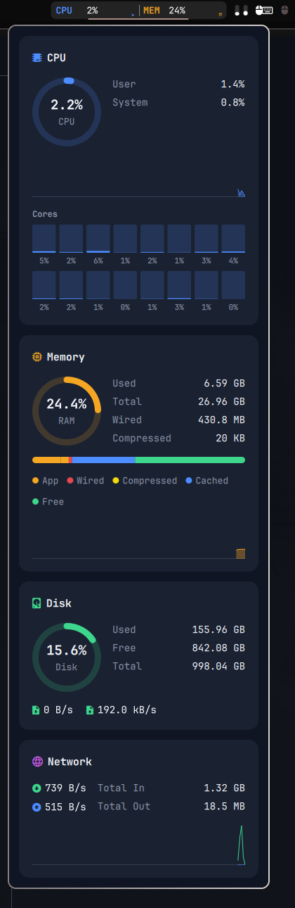

# System Monitor

CPU and memory with live sparklines in the Omarchy bar, and a panel with CPU, Memory, Disk and Network cards. A port of the macOS menu bar app [SWIFTUI_system_monitor](https://github.com/juancasanueva/SWIFTUI_system_monitor), with the same layout, palette and number formats.

<p align="center"></p>

## What it shows

- **Bar**: `CPU 12% ▁▂▃` `|` `MEM 59% ▃▃▄` on a small card. Each value has a fixed width, so the bar never shifts. The last 60 samples feed each sparkline.
- **CPU**: total usage ring, User and System, a two-minute history graph, and one bar per logical core. On Intel hybrid CPUs, P-Cores and E-Cores are shown as separate groups with their own averages.
- **Memory**: usage ring, Used, Total, Wired and Compressed, a stacked bar (App, Wired, Compressed, Cached, Free) with its legend, and a history graph.
- **Disk**: usage ring for `/`, Used, Free and Total, and read and write throughput.
- **Network**: download and upload rates, totals since boot, and a shared-scale graph of both.

The widget samples every 2 seconds, or every second while the panel is open. Disk capacity refreshes every 30 seconds and whenever the panel opens.

## How the numbers map to Linux

| Card value | Source |
| --- | --- |
| CPU total, User, System | `/proc/stat` deltas. Busy is everything except idle and iowait. User includes nice. System includes irq and softirq. |
| P-Cores / E-Cores | `/sys/devices/cpu_core/cpus` and `/sys/devices/cpu_atom/cpus`. If they are missing, all cores are shown in one "Cores" group. |
| Memory Used | `MemTotal - MemAvailable` |
| App | `AnonPages + Shmem` |
| Wired | `SUnreclaim + KernelStack + PageTables` (kernel memory that cannot be reclaimed) |
| Compressed | `Zswap` plus the RAM used by `zram0` (`mm_stat` mem_used_total) |
| Cached | `Buffers + Cached + SReclaimable - Shmem` |
| Disk capacity | `df -B1 --output=size,used,avail -- /`. Used is Total - Free, like the macOS card. |
| Disk throughput | `/proc/diskstats`, whole disks only (no partitions, dm, loop or zram) |
| Network | `/proc/net/dev`, without loopback and virtual links (bridges, containers, VPN tunnels) |

## Install

```sh
omarchy plugin add https://github.com/juancasanueva/omarchy-system-monitor.git --enable
```

Settings, in the widget's `shell.json` entry or under Setup > Bar:

| Key | Default | Effect |
| --- | --- | --- |
| `showCpu` | `true` | Show the CPU module in the bar |
| `showMemory` | `true` | Show the MEM module in the bar |

Click the widget, or run `omarchy-shell juancasanueva.system-monitor toggle`, to open the panel. Esc closes it.

## Privacy and side effects

The plugin only reads kernel files under `/proc` and `/sys` and runs `/usr/bin/df` with a fixed argument list. It makes no network requests, writes no files and stores no state. History lives in memory and resets when the shell restarts.

## Removing

```sh
omarchy plugin remove juancasanueva.system-monitor
```

Nothing persists after removal.

## Development

```sh
node tests/test_model.cjs        # parsers, arithmetic and formatters
omarchy plugin validate .
```

## License

MIT
